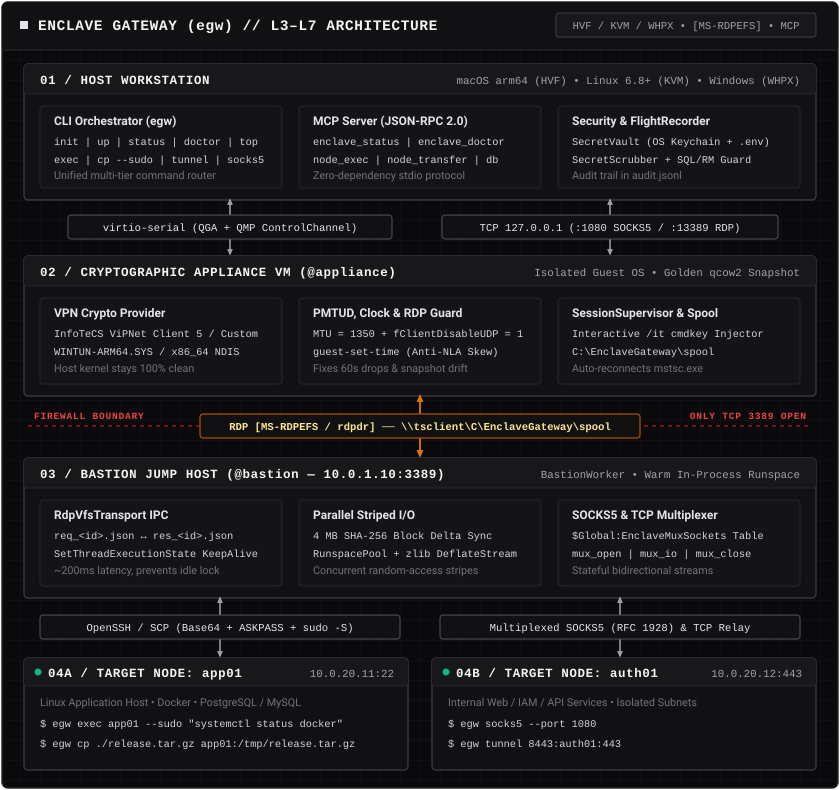

# Enclave Gateway (`egw`)

**Cross-Platform Cryptographic Appliance Orchestrator, RDP Virtual-Channel (`[MS-RDPEFS]`) Relay, Multi-Hop SSH Router, and Model Context Protocol (MCP) Server for Isolated Network Enclaves.**

---

Local security audit and compatibility limits: [31 October 2026 audit](docs/SECURITY_AUDIT_2026-10-31.md).
Functional follow-up: [scoped sync, provider lifecycle, OS isolation and running-worker verification](docs/FUNCTIONAL_HARDENING_2026-10-31.md).

Operation journals, principal grants, isolated qualification and Windows release procedure: [hardening guide](docs/HARDENING_AND_QUALIFICATION.md). Windows, RDPdr, vendor-driver and Authenticode acceptance remain separate from local runtime tests.

## Overview

Connecting modern developer workstations (**macOS on Apple Silicon `M1–M5`**, **modern Linux kernels `6.8+`**, or clean **Windows** hosts) to isolated corporate and government network enclaves protected by proprietary VPN clients (**InfoTeCS ViPNet Client 4/5**, etc.) and locked-down **RDP Jump Hosts (Bastions)** normally requires manual GUI workflows, dedicated laptops, or fragile nested quoting across multiple shells.

**Enclave Gateway (`egw`)** replaces manual GUI clicking with an automated, cross-platform L3–L7 gateway and RPC pipeline:

<p align="center">
  <picture>
    <source media="(prefers-color-scheme: dark)" srcset="docs/assets/architecture-dark.svg">
    <source media="(prefers-color-scheme: light)" srcset="docs/assets/architecture-light.svg">
    
  </picture>
</p>

---

## Key Engineering Capabilities

1. **Hardware-Accelerated Cross-Platform Appliance (`HVF` / `KVM` / `WHPX`)**
   * Builds ARM64 and x86_64 Windows appliance configurations. Native HVF/KVM/WHPX requires matching host and guest architectures; provider support must be qualified against the exact Windows installer and driver package. ViPNet Windows ARM64 compatibility is not established by this repository.
   * Keeps **Linux** (`6.8+` kernels where proprietary out-of-tree modules fail to build) and **Windows** host network stacks completely clean of third-party NDIS filter drivers.
   * Supports offline disk snapshots (`egw reset`) and Copy-on-Write profile overlays. Restore duration depends on storage and guest startup; disk snapshots do not include RAM or an independent NVRAM backup.

2. **Transactional RDP Virtual File System IPC (`RdpVfsTransport` over `[MS-RDPEFS]`)**
   * When an enterprise firewall blocks `SSH (22)`, `SMB (445)`, and `WinRM (5985/5986)` on the Jump Host—leaving only `RDP (3389/TCP)` open—`egw` mounts a shared spool directory over the RDP File System Virtual Channel (`\\tsclient\C\EnclaveGateway\spool`).
   * **In-Process `BastionWorker`**: dispatches payloads through PowerShell runspaces. The worker requires a policy-approved FullLanguage script; WDAC/AppLocker and endpoint controls remain applicable. Payloads may themselves launch native executables.
   * **Concurrency-Safe Envelopes**: pairs `req_<tx_id>.json` and `res_<tx_id>.json` with separated Base64-encoded `stdout` and `stderr` streams.

3. **Accelerated File Delivery (`Block-Level Delta Sync` + `Parallel Striped I/O`)**
   * Transfer throughput depends on the RDP client, round-trip delay, channel flow control, storage, and QGA serialization; benchmark the intended deployment.
   * `egw cp` computes a **4 MB block-level `SHA-256` manifest** on both ends, compresses changed blocks with `zlib`, and reads/writes stripes in parallel via a bounded PowerShell stripe `RunspacePool` (`Parallel Striped I/O`), verifying full-file `SHA-256` integrity before atomic rename.

4. **Bidirectional `SOCKS5`, `OpenSSH ProxyCommand`, & Multi-Port Multiplexer (`egw socks5` / `egw forward` / `egw stdio-proxy`)**
   * Exposes internal enclave web interfaces, APIs, and databases directly on the Host (`egw forward [--with-socks5]`, `egw tunnel`) or through an **RFC 1928 `SOCKS5` CONNECT proxy** (`egw socks5`) with automatic `TargetNode` alias resolution even when only `TCP 3389` is reachable on the Bastion.
   * Native **`OpenSSH ProxyCommand`** bridge (`egw stdio-proxy <host> <port>` + `egw ssh-config`) lets `ssh`, `scp`, `sftp`, `rsync`, `ansible`, and VS Code / Cursor Remote-SSH connect directly to `TargetNodes` over the RDP VFS channel.

5. **Automated Unattended Provisioning (`egw init`), CoW Profiles (`egw profile`), Watchdog (`egw watch`), & Interactive TUI (`egw top`)**
   * `egw init` generates architecture-aware (`arm64` / `x86_64`) `Autounattend.xml` and post-install provisioning media with `VirtIO` drivers, `QEMU Guest Agent`, `MTU=1350`, and optional MSI installation; key import requires a validated provider-specific procedure; `egw profile create <name>` provisions lightweight Copy-on-Write (`qcow2 -b`) overlays.
   * `egw top` renders a live terminal dashboard tracking `Host -> Appliance -> VPN -> Bastion -> TargetNodes`, while `egw watch` runs an autonomous self-healing loop (`doctor --fix`).

6. **VFS Transit, Binary SSH Streams, & `sudo` Injection**
   * Command scripts stream over SSH stdin with UTF-8 and normalized line endings; payloads are encoded where required by the control protocol. Command arguments and file paths are escaped separately.
   * File transfers to `TargetNodes` (`via: bastion`) transit directly through `\\tsclient\C\EnclaveGateway\spool` without writing temporary staging copies onto the Bastion's local `C:` disk, and automatically fall back to pure `ssh.exe` streaming (`cat > ...`) if `scp` / `sftp-server` is disabled on a hardened target.
   * Elevated `--sudo` operations use `sudo -S -p ''` without temporary password files. SSH askpass requires the managed native `egw-askpass.exe`, a valid Authenticode signature and an explicitly trusted signer by default. Its process environment is serialized. Base64 is transport encoding, not protection from privileged process inspection. Host keys must be provisioned before SSH connections.

7. **Built-In Model Context Protocol (MCP) Server (`egw mcp`)**
   * JSON-RPC 2.0 MCP server with newline stdio, optional Content-Length framing and stateless HTTP. Protocol versions 2024-11-05 and 2025-03-26 are negotiated; SSE/session resumption is not implemented. See the audit for validation boundaries.
   * Includes **Output Secret Scrubbing** (`[REDACTED]`) and **Destructive Command Guardrails** (`DROP`, `TRUNCATE`, `rm -rf /`, `shutdown` require explicit `confirm_destructive=True`).

---

## Operational Considerations

| Problem | Root Cause | How `enclave-gateway` Solves It |
|---|---|---|
| **RDP drops every ~60 seconds over ViPNet** (`Event 1026, Reason=267`) | Virtual `Infotecs` (`WinTun`) adapter defaults to `NlMtu = 65535`, while the tunnel silently drops `DF=1` packets >1420 bytes without ICMP fragmentation notices (PMTUD blackhole), and RDP-over-UDP sends unnegotiated 1500-byte datagrams. | `appliance_init.ps1` sets persistent `mtu=1350` on `Infotecs` and `Ethernet` interfaces and sets `fClientDisableUDP = 1` in registry policy. |
| **Post-snapshot clock drift (>5 min) breaks Kerberos / NLA (`CredSSP`) & TLS** | Restoring a `qcow2` snapshot (`egw reset`) or resuming after host sleep leaves the guest Windows clock hours or days behind; `w32tm` refuses large phase jumps and NTP (`UDP 123`) is blocked inside the enclave. | `QgaClient.sync_guest_clock()` (`guest-set-time`) and `appliance_init.ps1` (`-HostEpochUtc` + `MaxPosPhaseCorrection=0xFFFFFFFF`) deterministically align guest UTC time to the Host before RDP login. |
| **RDP idle timeout unmounts redirected drives** | Domain policy or session disconnection can remove the VFS channel. | Configure an approved RDP session policy and monitor reconnects. The worker does not call SetThreadExecutionState; that API does not override domain RDP idle policy. |
| **`cmdkey` updates via QGA fail NLA login (`LogonUI.exe`)** | QEMU Guest Agent runs as `NT AUTHORITY\SYSTEM` (Session 0), whereas `mstsc.exe` runs in the interactive desktop user session. Windows Credential Manager vaults are strictly isolated per session. | `session_supervisor.ps1` injects `cmdkey` credentials directly into the interactive user session via an ephemeral `/it` scheduled task (`UpdateEnclaveRDPCred`). |
| **Windows OpenSSH fails non-interactive password auth or root `scp` (`Permission denied`)** | Built-in Windows OpenSSH 7.7/8.1 rejects stdin passwords, and direct `scp` cannot write to root-owned `/etc` or `/opt` paths on Linux `TargetNodes`. | `SshHopExecutor` uses a preinstalled signed native `SSH_ASKPASS` helper, `egw ssh-copy-id <node>` key bootstrapping, and `egw cp --sudo` staging via `/tmp` + `sudo mv`. |
| **Spurious `invalid_grant` / auth failures in bash scripts called from PowerShell** | Windows PowerShell 5.1 pipelines append `\r\n` to every piped line; Linux `read -r` retains the trailing `\r` as part of the password string. | `SecretVault` and `SshHopExecutor` strip `\r` on both ingress and egress (`tr -d '\r'`). |

---

## Quick Start

### 1. Installation

```bash
git clone https://github.com/pom6i4/enclave-gateway.git
cd enclave-gateway
pip install -e .
```

### 2. Configuration

Copy the example topology and environment templates:

```bash
cp config/enclave.example.yaml enclave.yaml
cp config/.env.example .env
```

Or store credentials directly in your operating system's native Keychain (macOS Keychain / Linux Secret Service):

```bash
egw secret set ENCLAVE_BASTION_PASSWORD "your-secret-password"
egw secret set ENCLAVE_APP01_SUDO_PASSWORD "your-sudo-password"
```

### 3. CLI Usage

```bash
# Generate unattended Windows 11 Appliance provisioning bundle (Autounattend.xml + VirtIO + QGA)
egw init --output-dir ./build/provision --create-disk

# Start Appliance VM and run end-to-end L1–L7 diagnostics
egw up
egw doctor --fix

# Launch live interactive TUI topology monitor (or --once for snapshot)
egw top

# Self-heal clock drift, MTU=1350, UDP policy, interactive credentials, and Bastion RDP session
egw heal --update-credentials

# Bootstrap Bastion SSH key onto a TargetNode using password from OS Keychain
egw ssh-copy-id app01

# Execute commands across any tier of the topology (with optional in-memory --env / --secret-env)
egw exec @appliance "vipnetclient.exe info"
egw exec @bastion   "Get-NetTCPConnection -State Established"
egw exec app01      "docker ps --format 'table {{.Names}}\t{{.Status}}'"
egw exec app01 --sudo --env DEPLOY_ENV=prod --secret-env REG_TOKEN=ENCLAVE_REGISTRY_TOKEN "systemctl status docker"

# Transfer files or batch-synchronize entire directories (`egw cp` / `egw sync`) with optional --sudo
egw cp ./release.tar.gz app01:/tmp/release.tar.gz
egw cp --sudo ./nginx.conf app01:/etc/nginx/nginx.conf
egw sync --sudo ./helm/enclave-app app01:/opt/charts/enclave-app
egw sync app01:/var/log/nginx ./logs/nginx

# Launch an interactive SSH shell directly over `egw stdio-proxy` (or generate ~/.ssh/config)
egw ssh app01
egw ssh-config >> ~/.ssh/config

# Tunnel local port 8443 to internal service 10.0.20.12:443 over multiplexed RdpVfsTransport
egw tunnel 8443:auth01:443

# Concurrently start all declarative port forwards from enclave.yaml + SOCKS5 multiplexer
egw forward --with-socks5

# Generate ~/.ssh/config entries using `egw stdio-proxy %h %p` for native ssh/rsync/IDE Remote-SSH
egw ssh-config >> ~/.ssh/config

# Run autonomous self-healing watchdog (or purge session artifacts with `egw clean`)
egw watch --interval 15
egw clean

# Export Markdown audit report of session operations
egw report
```

### 4. MCP & Local LLM Server Configuration (All IDEs & Local Models)

Generate ready-to-use configurations for any IDE or local LLM stack automatically:

```bash
egw mcp-config --client all
# Or target a specific client: cursor | vscode | zed | continue | codex | claude-code | lm-studio | open-webui | ollama
```

#### Cursor / Claude Desktop / Windsurf / Cline / Roo Code / LM Studio (`mcp.json`)

```json
{
  "mcpServers": {
    "enclave-gateway": {
      "command": "egw",
      "args": ["-c", "/path/to/enclave.yaml", "mcp"]
    }
  }
}
```

#### VS Code (GitHub Copilot Agent Mode — `.vscode/mcp.json`)

```json
{
  "servers": {
    "enclave-gateway": {
      "type": "stdio",
      "command": "egw",
      "args": ["-c", "/path/to/enclave.yaml", "mcp"]
    }
  }
}
```

#### Zed IDE (`~/.config/zed/settings.json`)

`egw mcp` auto-detects both newline-delimited JSON and LSP `Content-Length` framing over `stdio`, and supports `resources/list` (`enclave://topology`, `enclave://status`) and `prompts/list`:

```json
{
  "context_servers": {
    "enclave-gateway": {
      "command": {
        "path": "egw",
        "args": ["-c", "/path/to/enclave.yaml", "mcp"],
        "env": {}
      }
    }
  }
}
```

#### Continue.dev in VS Code & JetBrains (`~/.continue/config.yaml` — Ollama / LM Studio / vLLM)

```yaml
mcpServers:
  - name: enclave-gateway
    command: egw
    args:
      - "-c"
      - "/path/to/enclave.yaml"
      - "mcp"
```

#### Claude Code CLI & OpenAI Codex CLI

```bash
# Claude Code CLI
claude mcp add enclave-gateway -- egw -c /path/to/enclave.yaml mcp

# OpenAI Codex CLI (~/.codex/config.toml)
egw mcp-config --client codex >> ~/.codex/config.toml
```

#### Local Models: Open WebUI, Ollama, vLLM, & llama.cpp (`egw mcp --listen`)

For browser-based local LLM frontends (**Open WebUI**, **AnythingLLM**, **LibreChat**) or custom **Ollama / vLLM / llama.cpp** agent scripts that require HTTP endpoints instead of `stdio`, start the built-in HTTP bridge:

```bash
# Start local HTTP bridge on 127.0.0.1:8765 (optional --token SECRET)
egw -c /path/to/enclave.yaml mcp --listen 127.0.0.1:8765
```

It exposes the following interfaces on the same port:
1. **OpenAPI 3.1 Tool Server for Open WebUI**: add `http://127.0.0.1:8765/openapi.json` under *Settings -> Tools -> Add Tool Server* in Open WebUI.
2. **Streamable HTTP MCP (`POST /mcp`)**: connect any HTTP-capable MCP client to `http://127.0.0.1:8765/mcp`.
3. **OpenAI / Ollama Function-Calling Schema (`GET /v1/tools` & `POST /v1/tools/call`)**:
   ```bash
   # Export OpenAI / Ollama tools array directly from CLI
   egw mcp --export-openai-tools > enclave_tools.json
   ```

---

## License

MIT License. See [LICENSE](LICENSE) for details.

## Security and compatibility defaults

- `egw mcp --read-only` permits structured reads and diagnosis without repair. It blocks arbitrary shell, SQL/HTTP calls, transfers, directory sync, tunnel changes and elevation. Regex command checks are guardrails rather than a sandbox.
- HTTP validates Origin and Host, limits connections and body size, and does not grant wildcard CORS. Use `ENCLAVE_MCP_TOKEN` or `--token-env` to avoid putting a bearer token in argv; `--allowed-origin` grants explicit browser access. Non-loopback binding requires a token; remote deployments also need TLS and an explicit origin policy.
- QGA IPC publishes requests through temp plus rename. QGA has no native file-rename command, so publication requires a guest command; polling uses direct file reads.
- Directory sync excludes `.env*`, `.ssh` and `.aws` by default and refuses unsafe tar members. Transfer an explicitly selected file separately when needed.
- Generated unattended media contains credentials and must remain private. CoW profiles copy topology and use separate NVRAM and planned ports; ports are not reserved until VM start.
