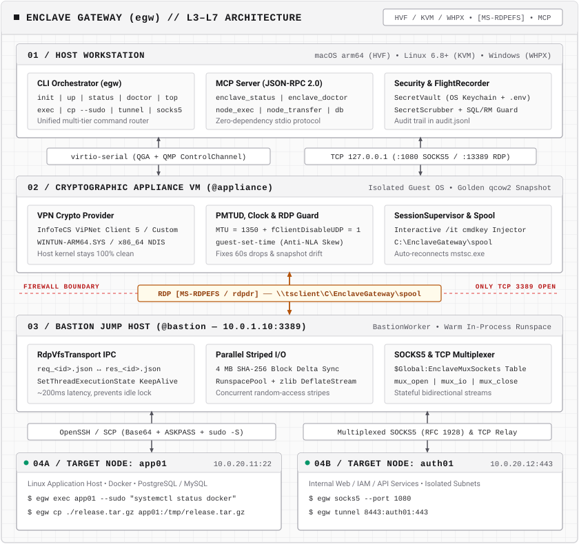

# Enclave Gateway (`egw`)

[English](README.md) · Русский

`egw` выполняет команды, передаёт файлы и пробрасывает TCP-соединения с хоста macOS, Linux или Windows через Windows-апплаенс с VPN и RDP-бастион. Этот маршрут работает и в топологии, где бастион принимает RDP, а входящий SSH на нём закрыт. CLI и MCP-клиенты на хосте обращаются к целевым узлам через настроенный маршрут.

Схема показывает RDP-маршрут. Если политика разрешает SSH, доступен
[маршрут без воркера на Bastion](docs/ru/ROUTING.md#ssh-разрешён).

<p align="center">
  <picture>
    <source media="(prefers-color-scheme: dark)" srcset="docs/assets/architecture-dark.svg">
    <source media="(prefers-color-scheme: light)" srcset="docs/assets/architecture-light.svg">
    
  </picture>
</p>

**Beta.** Standard предполагает доверие к оператору, RDP-сеансу и всем процессам с правом записи в спул. Enterprise требует проверенных подписей, закреплённых хешей и SID, свежей аттестации и нативной модели исполнения. В обоих режимах действуют политики Windows и правила доступа организации.

Текущая версия исходного кода — **0.3.0 Beta 1** (`0.3.0b1`). Подписанный
foreground-профиль `structured_only` является **экспериментальным** и требует
явного согласования с ИБ. Совместимость с KES не сертифицирована.
См. [границы выпуска](docs/RELEASING.md#current-beta-candidate).

## Возможности

- **Windows-апплаенс.** QEMU с HVF, KVM или WHPX при совместимой архитектуре хоста и гостя. Windows Direct использует существующий Windows-хост. Поддерживаются адаптеры `vipnet`, `kontinent`, `anyconnect`, `openvpn`, `wireguard` и `custom`. Проверка бинарника адаптера и допуск конкретного VPN-клиента к эксплуатации — отдельные этапы.
- **RDP-транспорт.** Обмен запросами и ответами через перенаправленный диск. По умолчанию используется `files`. Опциональный `stream` рассчитан на короткие команды и требует согласованной настройки на хосте и воркере.
- **SSH и файлы.** `egw exec`, `cp`, `sync`, интерактивный OpenSSH через `egw ssh`, локальные туннели и SOCKS5. SSH-клиент проверяет ключ сервера на том звене, где запускается.
- **MCP и эксплуатация.** Сервер поддерживает stdio и HTTP. Доступ ограничивается настроенной политикой. `egw doctor`, `status` и `transactions` помогают проверить маршрут и сверить исход операции.

## Быстрый старт

Для существующего контура нужны Python 3.10+, доступный канал QGA у Windows-апплаенса, согласованный маршрут VPN/RDP, PowerShell FullLanguage и OpenSSH на бастионе.

```sh
git clone https://github.com/pom6i4/enclave-gateway.git
cd enclave-gateway
python3 -m venv .venv
.venv/bin/python -m pip install -e .
.venv/bin/egw config init
# Укажите параметры ВМ, бастиона и целевого узла.
.venv/bin/egw config check
.venv/bin/egw doctor --preflight
.venv/bin/egw agents stage
```

На Windows используйте исполняемые файлы из `.venv\Scripts`. Откройте согласованный RDP-сеанс с перенаправлением диска и запустите напечатанную команду **в PowerShell на бастионе**. Настройте доверие к SSH-ключу целевого сервера и ключ входа на том звене, которое выполняет SSH. Затем проверьте маршрут.

```sh
.venv/bin/egw doctor --probe-targets
.venv/bin/egw exec app01 'id'
```

## Документация

- [Руководство на русском](docs/ru/GUIDE.md) и [полное руководство на английском](docs/GUIDE.md).
- [Архитектура безопасности и внедрение Enterprise](docs/ru/SECURITY.md).
- [Выбор SSH- или RDP-маршрута по политике ИБ](docs/ru/ROUTING.md).
- [Политики управляемых рабочих мест](docs/ENDPOINT-POLICY.md) на английском:
  новый профиль OpenSSH с ручным запуском и границы его проверки; ещё не выпущен.
- [Сборка, совместимость и релизная приёмка](docs/RELEASING.md) на английском.
- [Как внести вклад](CONTRIBUTING.md) на английском.

Лицензия [MIT](LICENSE).
